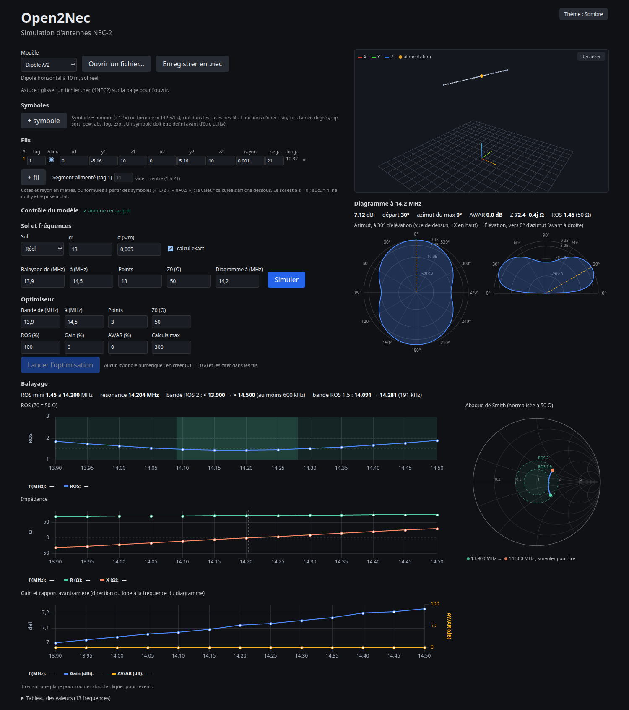

# Open2Nec

[](https://github.com/albertM-hub/open2nec/actions/workflows/ci.yml)

Interface web moderne pour simuler des antennes NEC-2 : géométrie, vue 3D, diagrammes de rayonnement, balayage en fréquence et optimisation.



Open2Nec is a modern web interface for NEC-2 antenna simulation. It relies on [OpenNEC](https://github.com/maurymarkowitz/OpenNEC) (`onec`), which performs all the calculations. The project is in alpha, so bugs and breaking changes are to be expected. Wire editor with symbols/formulas, 3D view, radiation patterns, frequency sweep with Smith chart, 4NEC2 .nec import/export, optimizer. Runs locally with Docker.

## Fonctions

- Tableau de fils avec symboles et formules
- Vue 3D de la géométrie
- Diagramme de rayonnement (coupes en azimut et en élévation)
- Balayage ROS et impédance, abaque de Smith
- Import et export de fichiers `.nec` (4NEC2)
- Optimiseur (ROS, gain, rapport avant/arrière)
- Modèles pré-remplis : dipôle, ground plane, Yagi 3 éléments, V inversé, quad 2 éléments
- Thème clair ou sombre

## Limites

- **NEC-2 seulement** : les cartes NEC-4 ne sont pas gérées.
- **`onec` est requis** : la version 2.3.3 est celle qui est testée. L'image Docker l'inclut.
- **Version alpha** : l'interface et le format des données peuvent encore changer.
- **Aucune authentification** : le conteneur écoute sur 127.0.0.1 seulement. Ne pas l'exposer sur un réseau.

## Essayer

### Avec Docker

Depuis la racine du dépôt :

```bash
docker compose -f docker/compose.yaml up -d --build
```

Puis ouvrir http://localhost:8080. Si le port est pris :

```bash
OPEN2NEC_PORT=8099 docker compose -f docker/compose.yaml up -d --build
```

Puis ouvrir http://localhost:8099. Installation de Docker, arrêt et mise à jour de `onec` : voir [docker/README.md](docker/README.md).

### Développement

Pré-requis : Python ≥ 3.10, Node.js (version 22 en CI) et le binaire `onec`, trouvé via la variable `OPEN2NEC_ONEC`, puis dans `bin/`, puis dans le `PATH` ([releases d'OpenNEC](https://github.com/maurymarkowitz/OpenNEC/releases)).

Depuis la racine du dépôt, de préférence dans un environnement virtuel Python, chaque ligne dans son terminal :

```bash
cd core && pip install -e ".[dev]" && pytest
cd api && pip install -e ../core -e ".[dev]" && uvicorn app.main:app --reload
cd web && npm install && npm run dev
```

## Architecture

```
core/   bibliothèque Python pure (modèle, cartes NEC, appel de onec, parseur)
api/    FastAPI : fine couche HTTP au-dessus du core
web/    Svelte + Vite + TypeScript (+ Three.js pour la 3D)
```

Règle d'or : `core` ne dépend jamais de FastAPI ni d'une interface.

## Avancement

Voir [docs/roadmap.md](docs/roadmap.md).

## Licence

MIT, Copyright 2026 Albert Müller (ON5AM). Voir [LICENSE](LICENSE). OpenNEC est distribué séparément sous sa propre licence MIT.

## Auteur

Albert Müller (ON5AM), [hamanalyst.org](https://hamanalyst.org).

Projet indépendant, non affilié à 4NEC2.
